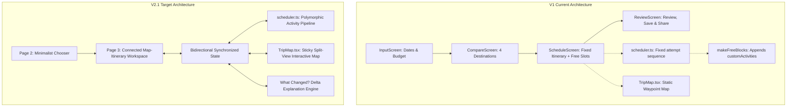
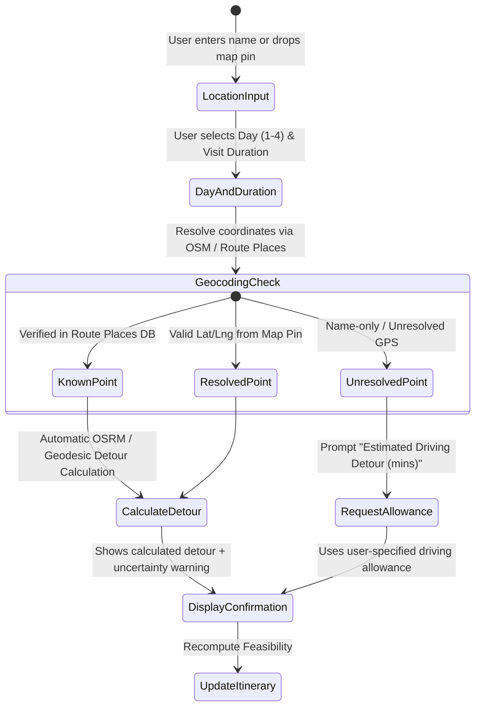
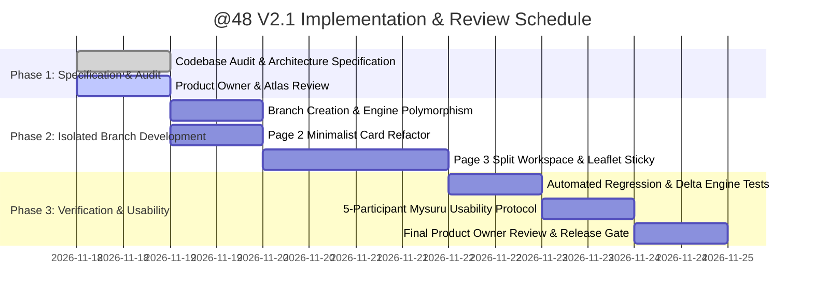

# @48 V2.1 — Interactive Trip Builder
## Comprehensive Architecture Audit, Technical Specification & Blueprint

**Document Version:** 2.1.0-SPEC  
**Status:** **Design Specification — NOT Approved for Implementation**  
**Production Baseline:** `3c3c652` on `main` (https://at48.vercel.app) — **UNTOUCHED & FROZEN**  
**Target Feature Branch (upon approval):** `feat/v2-interactive-trip-builder`  

---

## 1. Executive Summary & Policy Compliance

This document provides the foundational engineering audit, system architecture, and interaction specification for **@48 V2.1: Interactive Trip Builder ("Plan freely. Know what fits.")**.

In strict accordance with **Engineering Safeguard 8** and **Release Decision 9**:
1. **Production Freeze:** The live V1 production deployment (`https://at48.vercel.app`, commit `3c3c652`) remains completely untouched and active.
2. **Zero Premature Code Changes:** No code has been modified on `main` or pushed to production.
3. **Comprehensive Pre-Implementation Audit:** We have performed an exhaustive audit of the existing custom-activity, routing, scheduling, saving, and sharing implementations before drafting any replacement logic.
4. **Preserved Mapping Architecture:** Confirmed that `react-leaflet` + OpenStreetMap raster tiles + OSRM driving geometry will be preserved without migrating to external commercial APIs (Google Maps Platform/Mapbox).

---

## 2. Comprehensive Codebase Audit (Existing V1 Systems)



### Audit 1: Custom Activity & Free Leisure System
- **Current State:**
  - Defined in `src/types.ts` as `CustomPlannedActivity { id, day, name, durationMinutes, costPerPersonINR, slotStart }`.
  - Processed in `src/engine/scheduler.ts` inside `makeFreeBlocks()`.
  - Statically appended into unallocated time slots *only after* all predefined activities (Palace, Market) are placed.
- **Architectural Bottlenecks Identified:**
  1. *Second-Class Citizen:* Custom activities cannot be placed before or between predefined attractions; they are constrained strictly to leftover daylight slots.
  2. *Implicit Zero Detour:* In V1, custom activities assume 0 minutes of driving detour. If a user adds a café 15 km away, the engine naively treats transit time as 0 minutes, resulting in falsely optimistic return buffers.
  3. *No Category or Coordinate Metadata:* Custom activities lack categories (`Food`, `Attraction`, `Nature`, `Fuel`) and geospatial coordinates (`lat`, `lng`), preventing them from appearing as interactive pins on the map.
- **V2.1 Migration Strategy:**
  - Unify predefined attractions and custom user spots into a polymorphic `ItineraryItem` contract.
  - Require explicit detour estimation or manual allowance for every custom place.

---

### Audit 2: Routing, Mapping & Geospatial Infrastructure
- **Current State:**
  - Component: `src/components/TripMap.tsx` using `react-leaflet`, `leaflet`, and OpenStreetMap standard tiles.
  - Routing: Fetches GeoJSON polylines from the OSRM project API (`https://router.project-osrm.org/route/v1/driving/`) with an automatic offline fallback to straight-line waypoints.
  - Place Registry: `src/data/routePlaces.ts` containing 357 lines of verified OpenStreetMap nodes/ways for Bangalore, highway pitstops, and primary destination attractions.
- **Provider Migration Assessment:**
  - *Recommendation:* **DO NOT MIGRATE MAPPING PROVIDERS.**
  - *Justification:* `react-leaflet` with OpenStreetMap is completely open-source, requires zero API key provisioning, imposes zero per-load billing, works reliably in offline sandboxes, and already supports bounding-box fitting, custom HTML circle markers, popups, and road geometry polyline rendering.
- **V2.1 Workspace Requirements:**
  - On desktop, `TripMap` must be detached from sequential page scrolling and mounted into a sticky right-hand pane (`w-1/2` or `w-5/12`, `h-[calc(100vh-5rem)] sticky top-20`).
  - Add bidirectional hover/focus listeners: Hovering an itinerary item highlights its corresponding map marker; clicking a map marker scrolls the itinerary to that item.

---

### Audit 3: Scheduling Engine & Feasibility Mathematics
- **Current State:**
  - Evaluated in `src/engine/scheduler.ts` via `evaluateFeasibility(destination, constraints)`.
  - Calculates 20% highway contingency on one-way baseline drive.
  - Imposes preferred return departure at `min(15:00, deadline - inboundDrive - 120)` to ensure a comfortable arrival buffer.
  - Yields deterministic ratings: `Comfortable` ($\ge 120\text{m}$ buffer & slack), `Tight` ($< 120\text{m}$ buffer or slack), and `Not Recommended` (negative buffer or blocker).
- **V2.1 Feasibility Response Engine:**
  - Currently, feasibility is evaluated as a static snapshot.
  - V2.1 requires an explicit state transition diffing engine:
    $$\Delta \text{ActivityTime} = \text{ActivityTime}_{t+1} - \text{ActivityTime}_t$$
    $$\Delta \text{DriveTime} = \text{DriveTime}_{t+1} - \text{DriveTime}_t$$
    $$\Delta \text{ReturnBuffer} = \text{ReturnMargin}_{t+1} - \text{ReturnMargin}_t$$
  - Every confirmed edit generates a natural-language **"What changed?"** card derived strictly from these mathematical deltas.

---

### Audit 4: Trip Persistence & URL Sharing Protocol
- **Current State:**
  - Local Storage: `src/utils/savedTrips.ts` stores `SavedTrip` objects under key `at48_saved_trips`.
  - URL Serialization: `src/utils/tripShare.ts` serializes inputs into URLSearchParams (`v=1`, `dep`, `ret`, `pace`, `budget`, `party`, `adj`, `delay`, `stops`, `skip`, `ca`).
  - Custom activities currently serialize as:
    `ca=day~encName~durationMinutes~costPerPersonINR~slotStart`
- **Backward Compatibility Guarantee:**
  - Extend the serialization schema cleanly:
    `ca=day~encName~durationMinutes~costPerPersonINR~slotStart~detourMinutes~lat~lng~cat`
  - V1 links lacking the extra positional segments will parse default values (`detourMinutes = 0`, `lat = undefined`), ensuring zero breakage for existing shared URLs.

---

## 3. Page 2 — Minimalist Destination Chooser Specification

**Core Problem:** V1 destination cards were congested with travel pace selections, complex driving delay chips, and repeated technical calculations.  
**V2.1 Solution:** Streamline each card to present only high-signal decision metrics, moving deep calculation assumptions into an on-demand disclosure.

```
+-----------------------------------------------------------------------+
|  Dates: Sat, Oct 31, 08:00 - Sun, Nov 1, 20:30 (2 Days, 36.5 hrs)      |
+-----------------------------------------------------------------------+

+-----------------------------------------------------------------------+
|  [ Destination Photo ]                                                |
|  Mysuru                                       [ Comfortable (Green) ] |
|  -------------------------------------------------------------------  |
|  * Estimated Drive:      3h 15m each way (incl. 39m highway buffer)   |
|  * Usable Leisure Time:  6h 15m unhurried destination daylight        |
|  * Return Deadline Buffer: +2h 00m (Home by 18:30 vs 20:30 deadline)  |
|                                                                       |
|  [v] Why this result? (Click to view calculation assumptions)         |
|                                                                       |
|  [ Plan Mysuru Trip -> ]                                              |
+-----------------------------------------------------------------------+
```

### Element Breakdown & Display Rules

| Element | Specification & Source | Display Logic |
|---|---|---|
| **Header Banner** | Origin (`Koramangala, Bengaluru`), Departure, and Return Deadline | Displayed once at the top of the page; no per-card repetition. |
| **Card Identity** | Destination photo, title, distance (`145 km`), corridor name (`NH 275 Expressway`) | High-contrast typography with verified Wikimedia photography. |
| **Feasibility Badge** | `Comfortable` (Emerald), `Tight` (Amber), `Not Recommended` (Red) | Computed deterministically by `evaluateFeasibility()`. |
| **Estimated Drive** | Baseline minutes + 20% contingency | Clearly specifies the included planning buffer. |
| **Usable Leisure** | Daylight leisure slack calculated across dates | Computed daylight hours minus driving, meals, and rest. |
| **Return Buffer** | `+Xh Ym buffer before deadline` or `−Xh Ym projected late` | Prominently displayed; negative values highlighted in coral alert. |
| **"Why this result?"** | Expandable disclosure drawer / popover | Reveals: baseline drive assumption, 20% traffic buffer, 1 PM hotel check-in rule, and operating windows. |
| **Primary CTA** | `Plan Trip →` button | Navigates directly into Page 3 Interactive Trip Builder. |

---

## 4. Page 3 — Interactive Connected Workspace Specification

### 4.1 Desktop & Mobile Layout Architecture

```
DESKTOP (Split Workspace >= 1024px):
+-----------------------------------------------------------------------------------+
| Top Feasibility Bar: Return Margin: +2h 00m | Leisure: 6h 15m | [Review & Share ->] |
+------------------------------------------+----------------------------------------+
| LEFT PANE (Scrollable 55%):              | RIGHT PANE (Sticky 45%):               |
|                                          |                                        |
| [Tab: Itinerary] [Tab: Places to Visit]  | +------------------------------------+ |
|                                          | |                                    | |
| DAY 1 - Saturday, Oct 31                 | |       LEAFLET INTERACTIVE MAP      | |
| [08:00] Drive to Mysuru (3h 15m)         | |                                    | |
| [13:00] Meal & Check-in (1h 15m)         | |   [Origin: Bangalore]              | |
| [14:45] Mysore Palace (2h 30m) [x] [v]   | |          \                         | |
| [17:45] Devaraja Market (1h 00m) [x] [v] | |           [Stop: Maddur Tiffanys]  | |
| [18:45] Unallocated Leisure (2h 15m)     | |            \                       | |
|         [+ Add Place to this slot]       | |             [Destination: Mysuru]  | |
|                                          | |                                    | |
| DAY 2 - Sunday, Nov 1                    | |  * Synchronized Hover Highlights   | |
| ...                                      | |  * Zoom / Pan Bounds Fitted        | |
|                                          | +------------------------------------+ |
+------------------------------------------+----------------------------------------+
```

```
MOBILE (< 1024px):
+---------------------------------------------------------+
| Top Bar: Return Margin +2h 00m | [Review & Share]       |
+---------------------------------------------------------+
| Interactive Map View (Fixed 240px viewport)             |
|                                                         |
+---------------------------------------------------------+
| Collapsible Drag-Sheet:                                 |
| ===================== (Drag Handle) =================== |
| [Itinerary (2 Days)]  |  [Explore Places (12)]          |
|                                                         |
| Day 1 Schedule Cards with touch-friendly edit & remove  |
+---------------------------------------------------------+
```

---

### 4.2 Places to Visit & Place Categories
The workspace provides a curated place drawer categorized into 5 distinct categories:
1. **Popular:** Must-see landmarks (e.g. Mysore Palace, Chamundi Hill).
2. **Attractions:** Heritage sites, museums, viewpoints, and botanical gardens.
3. **Food:** Iconic highway eateries and heritage restaurants (e.g. Mylari Dosa, Maddur Tiffanys).
4. **Fuel:** Highway fuel stations and EV charging hubs along the verified expressway.
5. **Nature:** Lakes, waterfalls, bird sanctuaries (e.g. Ranganathittu Bird Sanctuary, Karanji Lake).

Each place card features:
- Place Name & Verified Category Tag
- Suggested Duration (e.g. `90 min recommended`)
- Verified Operating Window (only shown when evidenced by official tourism sources)
- Estimated Detour from Primary Route (e.g. `+10 min drive detour`)
- `Add to Trip` button with target Day selector

---

### 4.3 Add Your Own Spot & Routing Uncertainty Protocol

To prevent users from receiving deceptively optimistic feasibility results when adding custom spots, V2.1 introduces the **Explicit Detour Protocol**:



**Guardrail Rules:**
1. *No Silent Zero-Detour Assumption:* If a custom spot is added, the engine *must not* assume 0 travel time. It must either compute the road detour or mandate a user-entered transit allowance (default preset: `15m local transfer`).
2. *Uncertainty Warning Banner:* When coordinates are unverified or based on assumptions, the itinerary item displays:
   > ⚠️ *Unverified routing: Driving detour estimated at 15m. Verify live travel conditions before departure.*

---

### 4.4 Itinerary Editing Interactions
- **Remove Activity:** Clicking `[✕]` on any scheduled activity (predefined or custom) removes it from the timeline and shifts unallocated leisure into that block.
- **Reorder & Day Shift:** Users can move activities up/down or shift them between days (e.g. move Devaraja Market from Day 1 afternoon to Day 2 morning).
- **Duration Adjustment:** Quick inline stepper buttons (`−15m` / `+15m`) directly on the activity card.
- **Undo / Redo Stack:** In-memory immutable state history stack allowing users to revert accidental deletions or moves.

---

### 4.5 Feasibility Engine Response & "What Changed?" Explainer

Whenever the itinerary changes, the engine recalculates the full timeline and compares it against the prior state:

```typescript
export interface FeasibilityDiff {
  previousRating: FeasibilityRating;
  newRating: FeasibilityRating;
  deltaActivityMinutes: number;
  deltaDrivingMinutes: number;
  deltaReturnMarginMinutes: number;
  deltaSlackMinutes: number;
  explanation: string;
}

export function generateWhatChangedExplanation(diff: FeasibilityDiff): string {
  const parts: string[] = [];
  if (diff.deltaActivityMinutes !== 0) {
    const sign = diff.deltaActivityMinutes > 0 ? 'adds' : 'removes';
    parts.push(`${sign} ${Math.abs(diff.deltaActivityMinutes)} minutes at the destination`);
  }
  if (diff.deltaDrivingMinutes !== 0) {
    const sign = diff.deltaDrivingMinutes > 0 ? 'adds' : 'reduces';
    parts.push(`${sign} ${Math.abs(diff.deltaDrivingMinutes)} minutes of estimated driving`);
  }
  
  let bufferImpact = '';
  if (diff.deltaReturnMarginMinutes < 0) {
    bufferImpact = `Your return buffer has decreased by ${Math.abs(diff.deltaReturnMarginMinutes)} minutes.`;
  } else if (diff.deltaReturnMarginMinutes > 0) {
    bufferImpact = `Your return buffer has increased by ${diff.deltaReturnMarginMinutes} minutes.`;
  } else {
    bufferImpact = `Your return buffer remains unchanged.`;
  }
  
  return `This update ${parts.join(' and ')}. ${bufferImpact}`;
}
```

**Verification Rule:** This wording is strictly generated only when the underlying scheduling engine math produces matching delta numbers.

---

## 5. Prototype Validation Protocol (Section 7)

To validate the V2.1 hypothesis before any production release, a structured usability study with **5 participants** will be conducted on the Mysuru trip prototype:

### Study Parameters
- **Destination:** Mysuru (2 Days: Saturday 08:00 to Sunday 20:30, 2 travelers, ₹6,000 budget).
- **Assigned User Task:**
  > *"Plan a weekend trip to Mysuru. Keep Mysore Palace, add a café of your choice (e.g. Mylari or Depth N Green), remove an unwanted attraction (e.g. Devaraja Market Walk), and check whether you will return before your 20:30 deadline."*

### Quantitative & Qualitative Metrics Recorded
1. **Unassisted Task Completion Rate:** Target: 100% (5/5).
2. **Scroll Depth / Navigation Friction:** Measured by viewport distance scrolled compared to V1 baseline (target: $\ge 40\%$ reduction in vertical scroll distance).
3. **Time to Complete Customization:** Target: $< 90$ seconds.
4. **Feasibility Comprehension:** Participant correctly identifies their exact home arrival time and return buffer without confusion.
5. **Subjective Confidence Score:** Post-task Likert rating (1 to 5) on trip viability confidence.

> [!IMPORTANT]
> In accordance with Section 7 safeguards: *"Do not report improvement until it has been measured."* Improvement claims will only be published after empirical test completion.

---

## 6. Implementation Scope & Phased Roadmap



### Scope Boundaries

| Build First (V2.1 Scope) | Explicitly Deferred (Future Releases) |
|---|---|
| Simplified Page 2 destination cards with "Why this result?" | Adding new destinations outside the 4 primary corridors |
| Split-screen desktop workspace & mobile sheet | Live GPS / real-time traffic sensor integration |
| 5-category place discovery (Popular, Attractions, Food, Fuel, Nature) | Nationwide place search / commercial geocoding APIs |
| Custom spot entry with mandatory detour allowance | AI natural-language itinerary generation |
| Add, remove, reorder, and duration editing for activities | Real-time multi-user group collaboration |
| "What changed?" delta calculation engine | Live hotel and dining booking transactions |
| Responsive mobile/desktop synchronized Leaflet map | Migration to Google Maps Platform or Mapbox |

---

## 7. Next Steps & Approval Gate

1. **Awaiting Product Owner Review:** Review this specification, interaction model, and routing uncertainty rules.
2. **Implementation Trigger:** Only upon receiving explicit instruction to proceed with implementation will the isolated branch `feat/v2-interactive-trip-builder` be created.
3. **Zero Risk to Production:** Live production at `https://at48.vercel.app` remains completely stable on baseline `3c3c652`.
